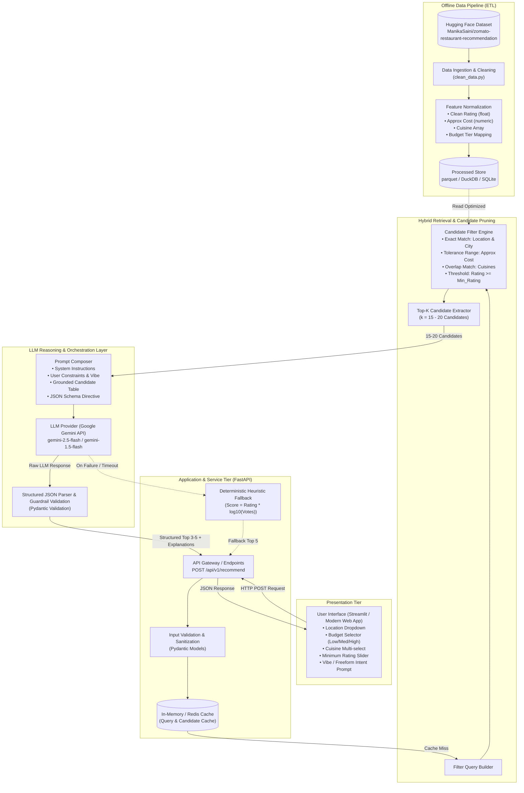
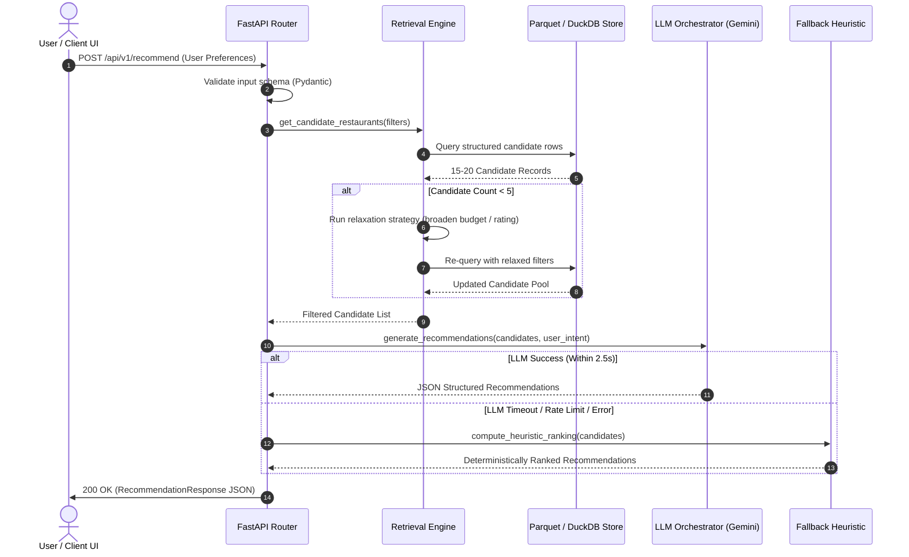

# System Architecture: AI-Powered Restaurant Recommendation System (Zomato Use Case)

---

## 1. Architectural Overview & Design Principles

The **AI-Powered Restaurant Recommendation System** is designed as a **Hybrid Retrieval-Augmented Recommendation (HRAR)** system. It marries deterministic tabular retrieval (fast, scalable, cost-effective filtering across structured restaurant attributes) with semantic LLM reasoning (nuanced understanding of subjective constraints, ranking, and human-like contextual justifications).

```
 ┌─────────────────┐       ┌────────────────────────┐       ┌───────────────────────┐
 │   User / UI     │ ────> │  API & Service Layer   │ ────> │  Retrieval & Cache    │
 │ (Web / Mobile)  │ <──── │   (FastAPI / Router)   │ <──── │  (DuckDB / Polars)    │
 └─────────────────┘       └───────────┬────────────┘       └───────────────────────┘
                                       │
                                       ▼
                           ┌────────────────────────┐
                           │   LLM Reasoning &      │
                           │   Re-Ranking Engine    │
                           │    (Gemini / GenAI)    │
                           └────────────────────────┘
```

### Core Design Principles
1. **Deterministic Pre-Filtering before LLM Reasoning**: Raw dataset records ($50,000+$) are never fed directly to the LLM. High-performance columnar/in-memory filters reduce the candidate space to a compact pool ($k \approx 10 - 20$), drastically minimizing latency, inference costs, and token consumption.
2. **Strict Grounding & Zero Hallucination**: The LLM acts as an evaluator and explainer over explicit candidate attributes. Strict prompts and schema enforcement prevent hallucinated names, fabricated menu items, or inaccurate ratings.
3. **Graceful Degradation & Fallbacks**: If external LLM APIs experience downtime, rate limits, or latency spikes, the system automatically falls back to deterministic heuristic ranking (e.g., weighted Bayesian rating $\times$ review volume) so user experience remains uninterrupted.
4. **Modular Decoupling**: Ingestion, candidate retrieval, LLM orchestration, and user interface are isolated into distinct services with strict Pydantic schemas.

---

## 2. End-to-End System Architecture

The following diagram illustrates the complete data flow, component interactions, and state boundaries across the application:



---

## 3. Subsystem Breakdown

### 3.1 Data Ingestion & Storage Pipeline (ETL)
- **Dataset Source**: `ManikaSaini/zomato-restaurant-recommendation` hosted on Hugging Face.
- **Data Preprocessing Operations**:
  1. **Rating Cleaning**: Extract numeric float from string notations (`"4.1/5"` $\rightarrow$ `4.1`). Replace non-ratings (`"NEW"`, `"-"`, `NaN`) with `0.0` or median imputation with an `is_rated` boolean flag.
  2. **Cost Normalization**: Strip commas and currency symbols (`"₹1,200"` or `"1,200"` $\rightarrow$ `1200` integer).
  3. **Cuisine Parsing**: Split delimited strings into normalized, lowercase token lists (`"North Indian, Chinese"` $\rightarrow$ `["north indian", "chinese"]`).
  4. **Budget Tier Tagging**:
     - **Low Budget**: $\le ₹400$ for two
     - **Medium Budget**: $₹401 - ₹1,200$ for two
     - **High Budget**: $> ₹1,200$ for two
  5. **Persistence Format**: Save cleaned data to **Apache Parquet** (`data/processed/zomato_cleaned.parquet`) or **DuckDB** for sub-10ms columnar analytical queries.

### 3.2 Candidate Retrieval Engine (Filtering Layer)
The retrieval layer reduces the search space using a multi-stage funnel:

```
Total Records (~50,000)
    │
    ▼ Stage 1: Location & City Match (Deterministic) ──> ~5,000 records
    │
    ▼ Stage 2: Cuisine Overlap & Rating Floor ──────────> ~500 records
    │
    ▼ Stage 3: Budget Bracket / Cost Boundary ──────────> ~50 records
    │
    ▼ Stage 4: Top-K Ranking by Popularity Score ────────> 15 - 20 Candidates
```

#### Relaxation Algorithm (When candidates $< 5$):
If strict criteria return too few candidates:
1. **Level 1**: Expand budget boundaries by $\pm 25\%$.
2. **Level 2**: Relax minimum rating threshold by $0.3$ points.
3. **Level 3**: Broaden cuisine matching from strict subset to partial match or top local specialties.

### 3.3 LLM Reasoning & Re-Ranking Engine
Once 15–20 candidates are extracted, the LLM performs the high-value cognitive tasks:
- **Semantic Understanding**: Interprets qualitative user intents (e.g., *"romantic ambiance"*, *"quick lunch between meetings"*, *"vegan options"*).
- **Comparative Ranking**: Re-orders the top 3–5 restaurants based on multidimensional fit.
- **Contextual Justification**: Writes clear, human-like explanations pointing directly to verified restaurant attributes.

#### Prompt Engineering Architecture:
```
┌──────────────────────────────────────────────────────────┐
│ SYSTEM DIRECTIVE                                         │
│ Role: Expert culinary concierge & dining recommender.    │
│ Grounding: Strict adherence to candidate context only.   │
│ Prohibitions: No hallucinated facts, prices, or menus.   │
├──────────────────────────────────────────────────────────┤
│ USER PROFILE & REQUIREMENTS                              │
│ • Location: Bangalore (Indiranagar)                     │
│ • Budget: Medium (~800-1200 for two)                     │
│ • Cuisines: Italian, Continental                         │
│ • Vibe / Special note: "Quiet corner for anniversary"    │
├──────────────────────────────────────────────────────────┤
│ CANDIDATE RESTAURANTS (Top 15 pre-filtered items)        │
│ [JSON / Markdown table of verified records]              │
├──────────────────────────────────────────────────────────┤
│ OUTPUT CONTRACT                                          │
│ Strict JSON matching RecommendationResponse schema.      │
└──────────────────────────────────────────────────────────┘
```

---

## 4. Data Contracts & API Specifications

### 4.1 Request Payload: `UserPreferenceRequest`
```json
{
  "location": "Indiranagar, Bangalore",
  "budget_tier": "medium",
  "cuisines": ["Italian", "Continental"],
  "min_rating": 4.0,
  "vibe_and_preferences": "Quiet, candle-lit ambiance for a date night with great desserts",
  "max_recommendations": 3
}
```

### 4.2 Response Payload: `RecommendationResponse`
```json
{
  "status": "success",
  "query_summary": {
    "location": "Indiranagar, Bangalore",
    "budget_tier": "medium",
    "total_candidates_analyzed": 16
  },
  "recommendations": [
    {
      "rank": 1,
      "name": "Milano Pizzeria & Trattoria",
      "location": "100 Feet Road, Indiranagar",
      "cuisines": ["Italian", "Pizza", "Desserts"],
      "rating": 4.4,
      "votes": 1820,
      "approx_cost_for_two": 1100,
      "highlights": ["Outdoor Seating", "Cozy Ambiance", "Craft Tiramisu"],
      "ai_explanation": "Perfect fit for an intimate date night. Milano offers authentic hand-tossed pizzas and artisan desserts within your medium budget, accompanied by a quiet outdoor patio praised in customer reviews.",
      "match_badge": "Best for Date Night"
    }
  ],
  "concierge_note": "Found 3 exceptional Italian spots in Indiranagar. Milano offers the best quiet ambiance, while option #2 has larger group portions if needed."
}
```

---

## 5. Sequence Diagram: Runtime Query Execution



---

## 6. Security, Resilience & Quality Guardrails

| Concern | Mitigation Strategy |
| :--- | :--- |
| **Hallucination Risk** | Candidates are injected into prompt context. The system prompt enforces: *"Recommend strictly from provided candidates. Do not create unlisted venues."* |
| **Prompt Injection** | User input in `vibe_and_preferences` is sanitized and quarantined in isolated JSON fields, preventing prompt overriding or delimiter hacking. |
| **API Rate Limiting & Cost** | Pre-retrieval reduces prompt tokens to $< 1,500$ tokens per query. Implemented query caching (hash of filters) prevents redundant LLM calls for repeated identical requests. |
| **Latency Budget** | Columnar querying takes $< 15\text{ms}$; LLM completion using flash-tier models (e.g. Gemini 2.5 Flash) responds in $\approx 1.2 - 2.0\text{s}$. Total roundtrip $< 2.5\text{s}$. |
| **Schema Integrity** | Pydantic response validation ensures that any malformed JSON output from the LLM is captured and parsed safely before reaching the client. |

---

## 7. Recommended Directory Structure

```
01-restaurant-recommendation/
├── data/
│   ├── raw/                      # Downloaded dataset from Hugging Face
│   └── processed/                # Cleaned parquet / duckdb database
│       └── zomato_cleaned.parquet
├── src/
│   ├── __init__.py
│   ├── config.py                 # Environment variables, model keys, thresholds
│   ├── data_pipeline/            # ETL scripts
│   │   ├── __init__.py
│   │   ├── download_dataset.py   # Hugging Face downloader
│   │   └── preprocess.py         # Cleaning, normalization, feature creation
│   ├── retrieval/                # Deterministic candidate retrieval
│   │   ├── __init__.py
│   │   ├── filter_engine.py      # DuckDB / Pandas candidate queries
│   │   └── relaxation.py         # Relaxation algorithms for sparse results
│   ├── llm/                      # LLM integration & prompt engineering
│   │   ├── __init__.py
│   │   ├── client.py             # LLM provider wrapper (Gemini / GenAI)
│   │   ├── prompts.py            # System prompts & few-shot templates
│   │   └── schemas.py            # Pydantic schemas for input & output
│   ├── services/                 # Recommendation orchestration
│   │   ├── __init__.py
│   │   ├── recommender.py        # Core pipeline coordinator
│   │   └── fallback.py           # Heuristic fallback ranker
│   └── api/                      # Backend API (FastAPI)
│       ├── __init__.py
│       └── main.py               # REST endpoints & dependency injection
├── ui/                           # Frontend presentation
│   └── app.py                    # Streamlit or Web UI client
├── tests/                        # Unit and integration test suites
│   ├── test_preprocessing.py
│   ├── test_retrieval.py
│   └── test_recommender.py
├── Doc/
│   ├── problemstatement.txt
│   ├── problemstatement.md
│   └── architecture.md
├── requirements.txt
├── README.md
└── architecture.md
```

---

## 8. Technology Stack Matrix

| Component | Selected Technology | Rationale |
| :--- | :--- | :--- |
| **Dataset Source** | Hugging Face Datasets API | Direct access to `ManikaSaini/zomato-restaurant-recommendation` |
| **Data Processing** | Python, Pandas, Polars | High-speed vectorized data transformation & cleaning |
| **Candidate Store** | Apache Parquet / DuckDB | Sub-millisecond columnar queries without database server overhead |
| **LLM Provider** | Google Gemini API (`google-genai`) | High reasoning capability, low latency (`gemini-2.5-flash`), cost-effective |
| **Validation & Typing** | Pydantic v2 | Robust schema definitions, JSON serialization, and guardrail parsing |
| **Application Backend** | FastAPI / Python 3.10+ | Asynchronous, auto-generating OpenAPI documentation, high performance |
| **Frontend UI** | Streamlit or Modern Web UI | Rapid interactive UI development with rich card formatting and sliders |
| **Testing** | Pytest, Unittest | Test coverage for data cleaning, edge cases, and prompt parsers |
