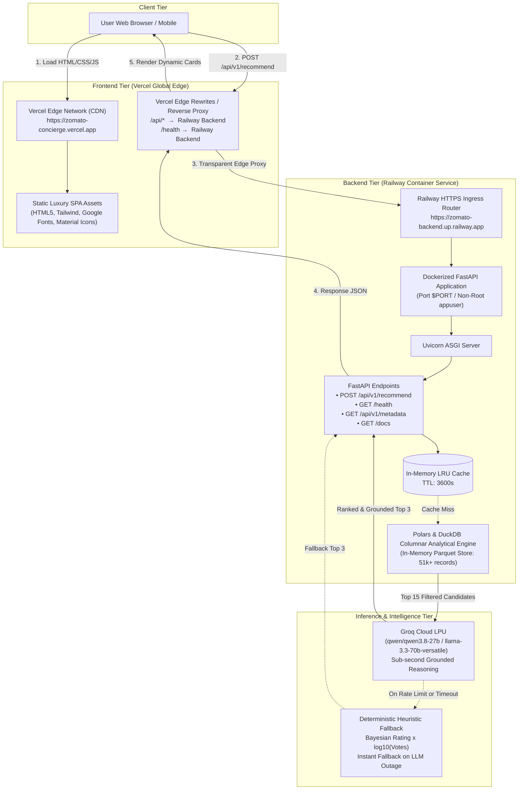
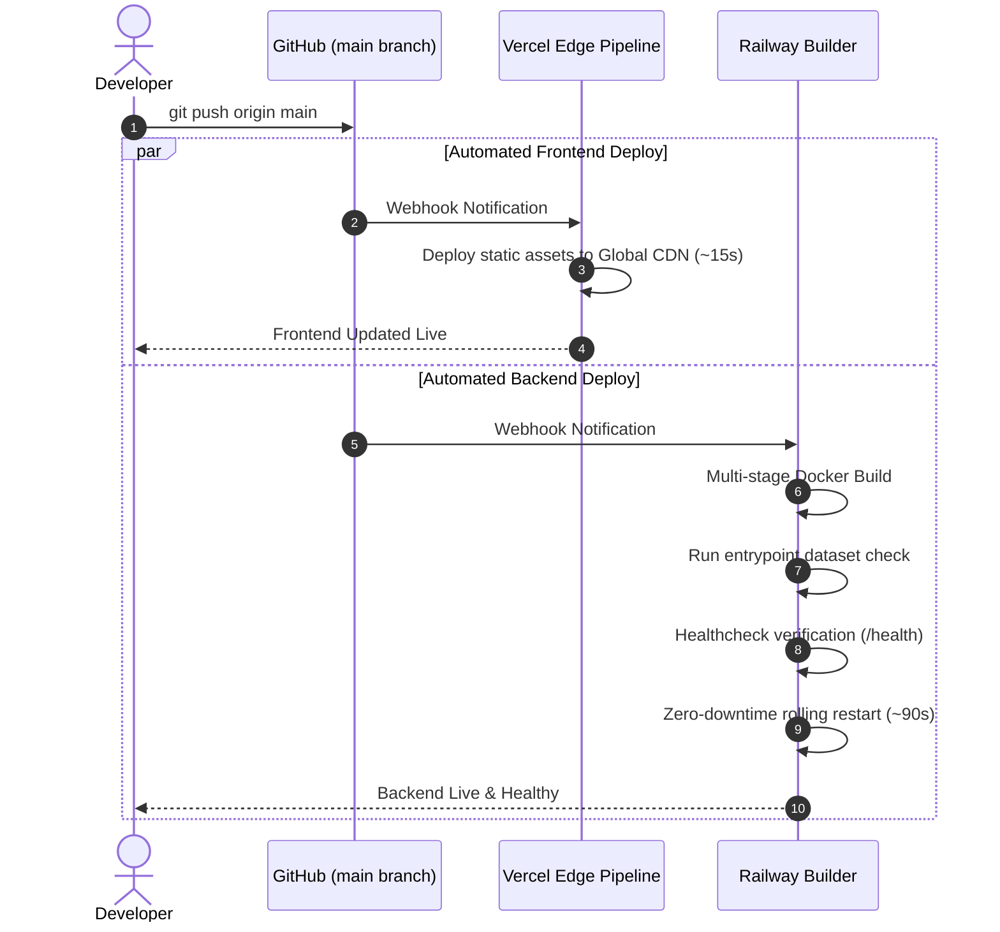

# Production Deployment Plan: Vercel (Frontend) + Railway (Backend)

This document outlines the end-to-end production deployment blueprint for the **AI Restaurant Recommendation Service (Zomato AI Concierge)** using a decoupled architecture:
- **Frontend Presentation Layer**: Hosted on **Vercel** (Global Edge CDN, instant TLS, zero-maintenance static hosting).
- **Backend API & Analytics Layer**: Hosted on **Railway** (Containerized FastAPI service, Polars/DuckDB in-memory retrieval engine, and Groq LPU cloud inference).

---

## 1. System Architecture & Network Data Flow

The application follows a decoupled **Jamstack + Containerized AI Microservice** design pattern. The user interacts with the high-performance dark luxury SPA served from Vercel's Edge network, which dispatches requests to the FastAPI backend running in an isolated Docker container on Railway.



### Communication Strategies

| Strategy | Description | Advantages | Implementation |
| :--- | :--- | :--- | :--- |
| **Strategy A: Vercel Edge Rewrites (Recommended)** | Vercel proxies `/api/*` directly to the Railway backend domain. The browser only talks to the Vercel domain. | **Zero CORS issues**, same-origin cookies, single unified domain name, prevents cross-site tracking blocks. | Handled automatically via committed [`vercel.json`](file:///c:/Users/DARSHAN/Documents/BitbyBit/AI/01%20Build%20Hour%20Restaurants%20Recommendation%20like%20Zomato/vercel.json) or [`frontend/vercel.json`](file:///c:/Users/DARSHAN/Documents/BitbyBit/AI/01%20Build%20Hour%20Restaurants%20Recommendation%20like%20Zomato/frontend/vercel.json). |
| **Strategy B: Direct Cross-Origin API Calls (CORS)** | Frontend directly requests `https://<railway-url>/api/v1/recommend`. | Direct connection bypassing Vercel proxies; useful for third-party client integrations. | Enabled via `CORS_ORIGINS` in Railway environment variables and `window.API_BASE_URL` in `frontend/index.html`. |

---

## 2. Pre-Deployment Readiness Checklist

Before beginning deployment, ensure:
- [ ] **GitHub Repository**: All project files are committed to a remote GitHub repository.
- [ ] **Groq Cloud API Key**: Active API key from [console.groq.com](https://console.groq.com).
- [ ] **Accounts Ready**:
  - [Railway Account](https://railway.app) (Free trial or Hobby tier).
  - [Vercel Account](https://vercel.com) (Hobby tier is 100% free).
- [ ] **Configuration Files Present**:
  - [`Dockerfile`](file:///c:/Users/DARSHAN/Documents/BitbyBit/AI/01%20Build%20Hour%20Restaurants%20Recommendation%20like%20Zomato/Dockerfile) & [`entrypoint.sh`](file:///c:/Users/DARSHAN/Documents/BitbyBit/AI/01%20Build%20Hour%20Restaurants%20Recommendation%20like%20Zomato/entrypoint.sh) (Docker containerization).
  - [`railway.json`](file:///c:/Users/DARSHAN/Documents/BitbyBit/AI/01%20Build%20Hour%20Restaurants%20Recommendation%20like%20Zomato/railway.json) (Railway build & deploy directives).
  - [`vercel.json`](file:///c:/Users/DARSHAN/Documents/BitbyBit/AI/01%20Build%20Hour%20Restaurants%20Recommendation%20like%20Zomato/vercel.json) & [`frontend/vercel.json`](file:///c:/Users/DARSHAN/Documents/BitbyBit/AI/01%20Build%20Hour%20Restaurants%20Recommendation%20like%20Zomato/frontend/vercel.json) (Vercel proxy rewrites).

---

## 3. Step 1: Deploy Backend to Railway

Deploy the backend first so you have your live Railway API URL ready to connect to Vercel.

### Step 1.1: Create Project on Railway
1. Log in to [Railway.app](https://railway.app).
2. Click **New Project** $\rightarrow$ **Deploy from GitHub repo**.
3. Select your repository: `01 Build Hour Restaurants Recommendation like Zomato` (or your repository name).
4. Railway will automatically detect the [`Dockerfile`](file:///c:/Users/DARSHAN/Documents/BitbyBit/AI/01%20Build%20Hour%20Restaurants%20Recommendation%20like%20Zomato/Dockerfile) and [`railway.json`](file:///c:/Users/DARSHAN/Documents/BitbyBit/AI/01%20Build%20Hour%20Restaurants%20Recommendation%20like%20Zomato/railway.json).

### Step 1.2: Configure Railway Environment Variables
In the Railway dashboard, select your newly created service and navigate to the **Variables** tab. Add the following variables:

| Variable Name | Value | Purpose |
| :--- | :--- | :--- |
| `GROQ_API_KEY` | `gsk_...` *(your key from Groq Console)* | **Required** for LLM recommendation reasoning. |
| `GROQ_MODEL` | `qwen/qwen3.8-27b` | Recommended model (or `llama-3.3-70b-versatile`). |
| `LOG_LEVEL` | `INFO` | Standard structured logging. |
| `ENABLE_QUERY_CACHE` | `true` | Enables sub-5ms caching for repeated queries. |
| `CACHE_TTL_SECONDS` | `3600` | 1-hour cache expiration. |
| `CORS_ORIGINS` | `*` *(or your Vercel domain once deployed)* | Allowed CORS origins for browser queries. |

*(Note: Do **NOT** manually set `PORT` on Railway. Railway automatically injects dynamic `$PORT`, and our [`entrypoint.sh`](file:///c:/Users/DARSHAN/Documents/BitbyBit/AI/01%20Build%20Hour%20Restaurants%20Recommendation%20like%20Zomato/entrypoint.sh) reads `${PORT:-8000}` automatically).*

### Step 1.3: Generate Public Domain
1. In the service view, click **Settings**.
2. Scroll to **Networking** $\rightarrow$ **Public Networking**.
3. Click **Generate Domain**.
4. Railway will generate a live HTTPS URL, e.g.:
   ```
   https://zomato-ai-concierge-production-ed3a.up.railway.app
   ```
5. **Copy this URL** — you will use it in Step 2.

### Step 1.4: Verify Backend Health
Test your live backend in a browser or terminal:
```bash
# Health Check Endpoint
curl -i https://zomato-ai-concierge-production-ed3a.up.railway.app/health
```

Expected JSON response:
```json
{
  "status": "healthy",
  "service": "AI Restaurant Recommendation API",
  "version": "1.0.0",
  "dataset_loaded": true,
  "total_records": 12530,
  "llm_configured": true,
  "groq_model": "qwen/qwen3.8-27b"
}
```

Interactive Swagger documentation is also immediately available at:
`https://zomato-ai-concierge-production-ed3a.up.railway.app/docs`

---

## 4. Step 2: Deploy Frontend to Vercel

### Step 2.1: Update Vercel Rewrites with your Railway URL
Before deploying to Vercel, replace `YOUR-RAILWAY-APP.up.railway.app` with your actual Railway URL in the rewrite configuration:

In [`frontend/vercel.json`](file:///c:/Users/DARSHAN/Documents/BitbyBit/AI/01%20Build%20Hour%20Restaurants%20Recommendation%20like%20Zomato/frontend/vercel.json):
```json
{
  "$schema": "https://openapi.vercel.sh/vercel.json",
  "cleanUrls": true,
  "rewrites": [
    {
      "source": "/api/:match*",
      "destination": "https://zomato-ai-concierge-production-ed3a.up.railway.app/api/:match*"
    },
    {
      "source": "/health",
      "destination": "https://zomato-ai-concierge-production-ed3a.up.railway.app/health"
    }
  ]
}
```

*(And correspondingly in [`vercel.json`](file:///c:/Users/DARSHAN/Documents/BitbyBit/AI/01%20Build%20Hour%20Restaurants%20Recommendation%20like%20Zomato/vercel.json) if deploying from the root).*

Commit and push these changes to GitHub:
```bash
git add .
git commit -m "Configure Railway URL in Vercel rewrites"
git push
```

---

### Step 2.2: Import Project on Vercel

1. Log in to [Vercel.com](https://vercel.com).
2. Click **Add New...** $\rightarrow$ **Project**.
3. Select your GitHub repository.
4. In the **Configure Project** screen:
   - **Project Name**: `zomato-ai-concierge` (or any custom name).
   - **Framework Preset**: Select **Other**.
   - **Root Directory**: Click **Edit** and choose `frontend` (Recommended), or leave as `./` if using root `vercel.json`.
   - **Build and Output Settings**: Leave defaults (no build command needed for pure static HTML/JS).
5. Click **Deploy**.
6. Vercel will complete deployment in ~15 seconds and assign a production URL:
   ```
   https://zomato-ai-concierge.vercel.app
   ```

---

## 5. End-to-End Verification & Sanity Testing

Test the live connected pipeline directly from your browser:

1. **Open the Vercel App**: Visit `https://<your-vercel-domain>.vercel.app`.
2. **Verify Static Assets**: Ensure the dark luxury aesthetic, Google Fonts (*Bodoni Moda*, *Plus Jakarta Sans*), and embedded icons render crisply.
3. **Execute a Recommendation Query**:
   - Location: `Indiranagar`
   - Budget: `Medium`
   - Cuisines: `Italian`, `Continental`
   - Minimum Rating: `4.0`
   - Vibe Prompt: *"Romantic candle-lit date night with artisan pasta and wine"*
   - Click **Curate Royal Recommendations**.
4. **Inspect Network Activity**:
   - In Chrome DevTools $\rightarrow$ Network tab, observe the request to `/api/v1/recommend`.
   - Notice HTTP status `200 OK` returned in $< 1$ second.
   - Observe the response header `x-response-time-ms` showing Groq LPU latency.
   - Cards dynamically populate with AI Concierge justifications (*Maître D' Verdict*).

---

## 6. Continuous Deployment (CI/CD) Workflow

Pushing code to the `main` branch automatically triggers synchronized deployments:



---

## 7. Cost & Resource Sizing (Vercel + Railway)

| Component | Platform | Plan | Monthly Cost | Included Resources |
| :--- | :--- | :--- | :--- | :--- |
| **Frontend SPA** | **Vercel** | Hobby | **$0.00 / month** | 100 GB bandwidth, unlimited global edge requests, automated SSL. |
| **Backend API** | **Railway** | Trial / Hobby | **$0.00 - $5.00 / mo** | 8 GB RAM, 8 vCPUs (shared), $5 free usage credit per month. |
| **LLM Inference** | **Groq Cloud** | Free Developer Tier | **$0.00 / month** | 30 requests/min, 14,400 requests/day for `qwen/qwen3.8-27b`. |
| **Total Estimated Spend** | — | — | **$0.00 - $5.00 / mo** | **Full production deployment at near-zero cost.** |

---

## 8. Troubleshooting & Common Gotchas

### 1. Vercel Rewrite returns `502 Bad Gateway` or `404 Not Found`
- **Cause**: The Railway destination URL in `vercel.json` has an incorrect syntax or Railway is still building.
- **Fix**: Verify your Railway backend URL is healthy by visiting `https://<railway-url>/health` in your browser. Ensure the rewrite in `vercel.json` contains `https://` and does not have duplicate trailing slashes.

### 2. CORS Error when calling Railway directly
- **Cause**: The frontend is sending requests directly to Railway without Vercel rewrites, and Railway does not allow the Vercel domain.
- **Fix**: In Railway, add the environment variable:
  ```env
  CORS_ORIGINS=https://<your-vercel-domain>.vercel.app,http://localhost:3000
  ```
  FastAPI will reload and permit cross-origin requests.

### 3. Missing Dataset on Railway (`FileNotFoundError`)
- **Cause**: `data/processed/zomato_cleaned.parquet` was excluded via `.gitignore`.
- **Fix**: The provided [`entrypoint.sh`](file:///c:/Users/DARSHAN/Documents/BitbyBit/AI/01%20Build%20Hour%20Restaurants%20Recommendation%20like%20Zomato/entrypoint.sh) detects this automatically and runs `download_dataset.py` followed by `preprocess.py` on the first container boot. Ensure Railway has outbound internet access (standard on all plans).

### 4. Groq Rate Limit (HTTP 429)
- **Behavior**: If Groq API rate limits are exceeded during traffic surges, the service **does not crash**.
- **Self-Healing**: The engine automatically catches the exception and falls back to deterministic multi-factor heuristic ranking (`status="fallback"`). The user still receives recommendations with a banner notifying them of fallback mode.

---

## 9. Rollback & Disaster Recovery Playbook

If an issue occurs after a deployment:
- **Instant Frontend Rollback**: In the Vercel Dashboard $\rightarrow$ **Deployments** $\rightarrow$ Click the **three dots (...)** on the previous working deployment $\rightarrow$ Click **Instant Rollback**. Takes $< 3$ seconds.
- **Instant Backend Rollback**: In Railway Dashboard $\rightarrow$ Click your service $\rightarrow$ **Deployments** $\rightarrow$ Click on the previous successful deployment $\rightarrow$ Click **Redeploy**.
