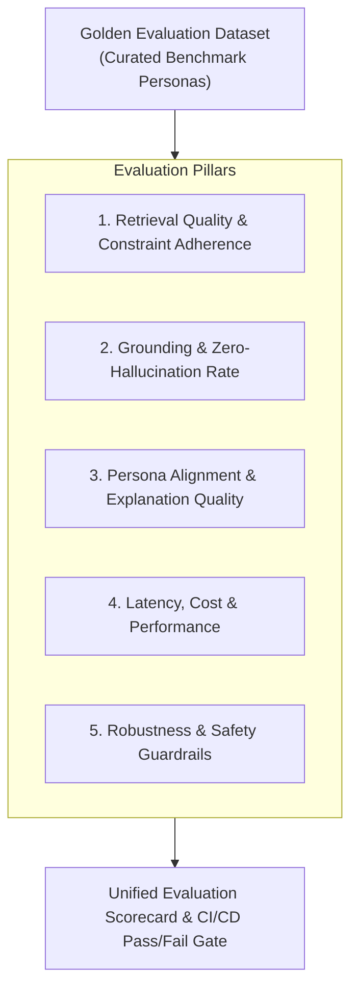
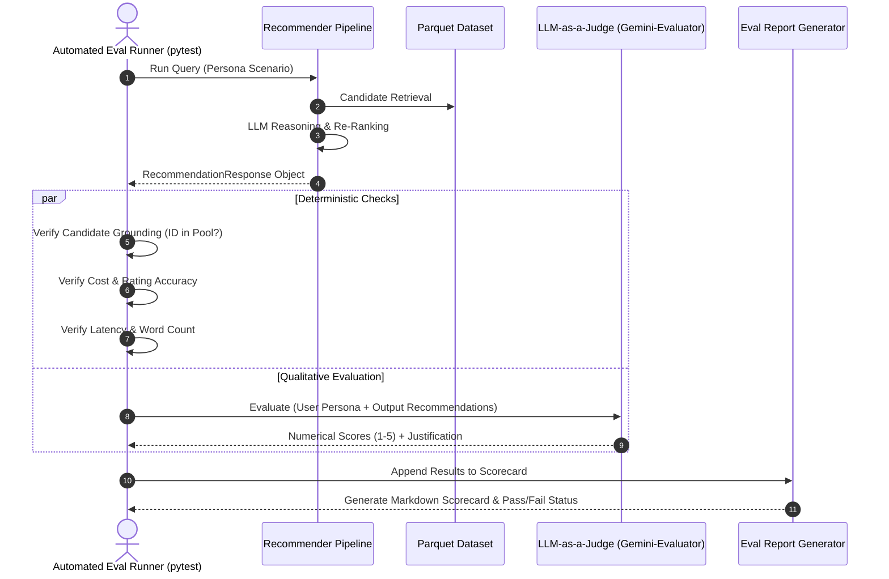

# Evaluation Framework & Benchmark Guide: AI-Powered Restaurant Recommendation System

This document outlines the evaluation methodology, benchmarking metrics, automated test harness, and quality thresholds for validating the **AI-Powered Restaurant Recommendation System (Zomato Use Case)**.

---

## 1. Evaluation Philosophy & Dimensions

Evaluating a **Hybrid Retrieval-Augmented Recommendation (HRAR)** system requires assessing both deterministic data retrieval and non-deterministic LLM reasoning. Our evaluation framework measures five distinct pillars:



---

## 2. Quantitative Evaluation Metrics & Thresholds

| Dimension | Metric | Formula / Definition | Target Threshold | Minimum Acceptable |
| :--- | :--- | :--- | :---: | :---: |
| **Retrieval** | **Constraint Adherence Rate** | $\frac{\text{Candidates matching all hard filters}}{\text{Total Candidates Retrieved}}$ | **100%** | $\ge 95\%$ |
| **Retrieval** | **Precision@K ($k=5$)** | $\frac{\text{Relevant items in top } K}{K}$ | $\ge 85\%$ | $\ge 75\%$ |
| **Retrieval** | **Diversity / De-duplication** | Max distinct brands in top $K$ (no single chain dominates) | $\ge 80\%$ unique | $\ge 70\%$ unique |
| **Grounding** | **Hallucination Rate** | $\frac{\text{Output venues NOT in candidate pool}}{\text{Total Output Venues}}$ | **0.0%** (Strict) | **0.0%** |
| **Grounding** | **Attribute Accuracy** | Match rate between output cost/rating and raw dataset | **100%** | $\ge 98\%$ |
| **Explanation** | **Persona Relevance Score** | LLM-as-a-Judge 1–5 rubric evaluating fit to user vibe | $\ge 4.2 / 5.0$ | $\ge 3.8 / 5.0$ |
| **Explanation** | **Length & Conciseness** | Word count per restaurant explanation | $35 - 55$ words | $\le 70$ words |
| **Performance** | **End-to-End Latency ($p95$)** | Wall-clock time from API request to response | $\le 2.0\text{s}$ | $\le 3.0\text{s}$ |
| **Performance** | **Retrieval Engine Time** | Time taken by DuckDB/Polars candidate pruner | $\le 15\text{ms}$ | $\le 30\text{ms}$ |
| **Resilience** | **Fallback Recovery Rate** | Success rate when LLM API is unavailable/timed out | **100%** | **100%** |
| **Safety** | **Prompt Injection Pass Rate** | % of adversarial injection prompts safely quarantined | **100%** | **100%** |

---

## 3. Golden Benchmark Dataset (Evaluation Personas)

To objectively benchmark recommendations, the system is tested against 5 standardized persona test cases representing realistic and diverse dining needs.

### Persona 1: *The Budget Solo Diner*
- **Location**: `Koramangala, Bangalore`
- **Budget**: `Low` ($\le ₹400$ for two)
- **Cuisine**: `["Fast Food", "Street Food", "Rolls"]`
- **Min Rating**: `3.8`
- **Vibe / Freeform**: *"Quick, pocket-friendly lunch on the go, no long waiting time"*
- **Expected Outcome**:
  - Recommends quick-service stalls/eateries with fast turnaround.
  - Price strictly $< ₹400$.
  - AI explanation highlights speed and value for money.

### Persona 2: *The Romantic Anniversary Date*
- **Location**: `Indiranagar, Bangalore`
- **Budget**: `High` ($> ₹1,200$ for two)
- **Cuisine**: `["Italian", "Continental"]`
- **Min Rating**: `4.3`
- **Vibe / Freeform**: *"Quiet, intimate candle-lit atmosphere with great craft wine/desserts"*
- **Expected Outcome**:
  - Recommends fine-dining or upscale bistros with outdoor/candle-lit ambiance tags.
  - Rating $\ge 4.3$.
  - AI explanation emphasizes ambiance, privacy, and signature desserts.

### Persona 3: *The Multi-Generational Family Gathering*
- **Location**: `Connaught Place, Delhi`
- **Budget**: `Medium` ($₹500 - ₹1,200$ for two)
- **Cuisine**: `["North Indian", "Mughlai"]`
- **Min Rating**: `4.0`
- **Vibe / Freeform**: *"Spacious seating, family-friendly, pure vegetarian options, attentive staff"*
- **Expected Outcome**:
  - Recommends established family restaurants with large table capacities.
  - Verified vegetarian menu options.
  - No noisy nightlife or pub-first venues.

### Persona 4: *The Health-Conscious Professional*
- **Location**: `HSR Layout, Bangalore`
- **Budget**: `Medium` ($₹400 - ₹1,000$ for two)
- **Cuisine**: `["Healthy Food", "Salads", "Cafe"]`
- **Min Rating**: `4.1`
- **Vibe / Freeform**: *"Fresh salads, gluten-free options, great cold brew coffee for a remote work lunch"*
- **Expected Outcome**:
  - Recommends health cafes with salad bowls and cafe seating.
  - AI badge identifies "Best for Healthy Bites" or "Work-Friendly Cafe".

### Persona 5: *The Edge-Case / Conflicting Constraints Probe*
- **Location**: `Whitefield, Bangalore`
- **Budget**: `Low` ($\le ₹300$ for two)
- **Cuisine**: `["Japanese", "Sushi"]`
- **Min Rating**: `4.5`
- **Vibe / Freeform**: *"Authentic fresh sashimi in a luxury fine dining setup"*
- **Expected Outcome**:
  - Detects that authentic luxury Japanese cannot be satisfied under ₹300.
  - Triggers constraint relaxation with transparent disclaimer in `concierge_note`.
  - Recommends closest accessible alternatives (e.g., budget Asian noodles or authentic Japanese at relaxed price points).

---

## 4. Automated Evaluation Pipeline Architecture



---

## 5. LLM-as-a-Judge Evaluation Prompt

To evaluate qualitative metrics (Persona Fit, Persuasiveness, Tone), we use a secondary evaluation agent with a structured rubric:

```markdown
You are an expert culinary critic and evaluation judge evaluating an AI Restaurant Recommender.

### INPUT DATA:
1. User Query & Preferences:
{{user_query}}

2. Verified Candidate Pool Provided to Recommender:
{{candidate_pool}}

3. Recommender Output:
{{recommender_output}}

### EVALUATION CRITERIA (Score 1 to 5 for each):
1. RELEVANCE & FIT: Does the recommendation align with the user's explicit location, budget, cuisine, and subjective vibe?
   - 1 = Completely irrelevant (mismatched cuisine/budget/vibe)
   - 3 = Meets hard criteria but ignores qualitative vibe
   - 5 = Exceptional alignment with both hard criteria and nuanced vibe

2. GROUNDING & FAITHFULNESS: Are all claimed restaurant highlights, prices, and features verified by the candidate data?
   - 1 = Hallucinated venues or fabricated ratings/prices
   - 3 = Minor unsupported claims about menu items
   - 5 = Completely grounded; zero hallucinations

3. EXPLANATION CLARITY & VALUE: Is the explanation concise (under 60 words), persuasive, and genuinely helpful to a diner?
   - 1 = Generic filler text ("This restaurant is good because it has food")
   - 3 = Repetitive or overly verbose
   - 5 = Engaging, human-like, and directly cites relevant restaurant features

### OUTPUT FORMAT:
Output strict JSON:
{
  "relevance_score": 5,
  "grounding_score": 5,
  "clarity_score": 5,
  "total_score": 15,
  "judge_feedback": "Excellently matched the quiet anniversary vibe with Toscano's outdoor patio."
}
```

---

## 6. Performance & Load Benchmarking

### Benchmarking Suite Commands
Run performance tests using the test harness:

```bash
# 1. Run all unit and deterministic evaluation tests
pytest tests/ -v -m "not slow"

# 2. Run end-to-end benchmark personas with LLM evaluation
pytest tests/test_benchmarks.py -v --eval-llm

# 3. Run latency & throughput stress test (50 concurrent requests)
python scripts/benchmark_latency.py --concurrency 10 --iterations 50
```

### Latency Budget Allocation

```
Total Latency Target: <= 2,000 ms
├── API Gateway Overhead:           <= 10 ms
├── Columnar Candidate Retrieval:   <= 15 ms
├── Prompt Formatting & Prep:       <= 5 ms
├── Gemini Flash LLM Call:          <= 1,800 ms
├── Response Schema Parsing:        <= 15 ms
└── Response Serialization:         <= 5 ms
```

---

## 7. CI/CD Quality Gate & Regression Policy

Before any PR or major commit is merged into `main`:
1. **Zero Hallucination Rule**: Any test case showing an unverified restaurant name causes an immediate build failure.
2. **Schema Integrity Rule**: 100% of responses must validate against `RecommendationResponse` Pydantic model.
3. **Latency Regression Rule**: $p95$ latency across the 5 Golden Personas must not exceed $3.0$ seconds.
4. **Fallback Integrity Rule**: Fallback ranker must achieve $100\%$ availability when Gemini API is mocked as offline.
