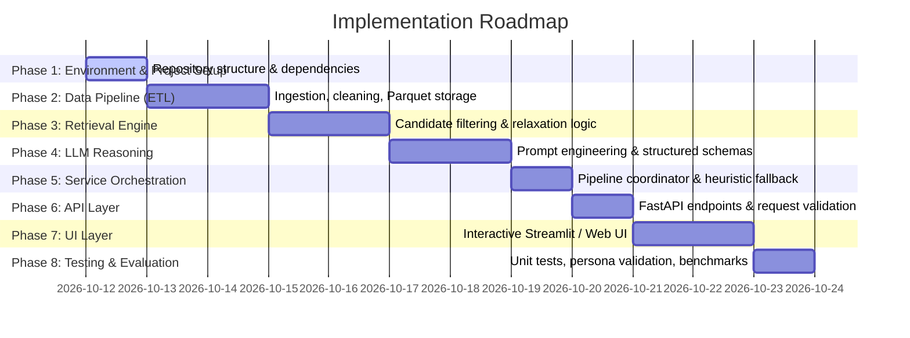

# Phase-Wise Implementation Plan: AI-Powered Restaurant Recommendation System

This implementation plan outlines the step-by-step engineering roadmap for building the **AI-Powered Restaurant Recommendation System (Zomato Use Case)** based on the specifications defined in [Doc/problemstatement.md](file:///c:/Users/DARSHAN/Documents/BitbyBit/AI/01%20Build%20Hour%20Restaurants%20Recommendation%20like%20Zomato/Doc/problemstatement.md) and [Doc/architecture.md](file:///c:/Users/DARSHAN/Documents/BitbyBit/AI/01%20Build%20Hour%20Restaurants%20Recommendation%20like%20Zomato/Doc/architecture.md).

---

## 1. Roadmap & Phase Summary

| Phase | Focus Area | Key Output / Artifact |
| :--- | :--- | :--- |
| **Phase 1** | **Setup & Foundation** | Virtual environment, project tree, `requirements.txt`, configuration module |
| **Phase 2** | **Data Pipeline (ETL)** | Hugging Face ingestion script, cleaning & normalization, `zomato_cleaned.parquet` |
| **Phase 3** | **Candidate Retrieval Engine** | High-performance filtering engine (DuckDB/Polars), multi-tier relaxation logic |
| **Phase 4** | **LLM Integration & Prompts** | Groq API wrapper (`groq` SDK), structured prompt templates, Pydantic schemas |
| **Phase 5** | **Service Orchestration** | End-to-end recommender service, caching mechanism, heuristic fallback engine |
| **Phase 6** | **API Layer** | FastAPI application, `/api/v1/recommend` endpoint, health check & documentation |
| **Phase 7** | **Frontend Presentation** | Interactive Streamlit / Web application with filters, sliders, and AI cards |
| **Phase 8** | **Testing & Validation** | Test suite (pytest), evaluation against real user personas, performance audit |

---

## 2. Detailed Phase Breakdown

### Phase 1: Environment Setup & Project Foundation

#### Objective
Establish an isolated, reproducible development environment, directory skeleton, dependency configurations, and environment variable management.

#### Tasks
- [x] **1.1 Directory Tree Setup**: Scaffold the directory layout matching the architecture specification:
  - `data/raw/`, `data/processed/`
  - `src/data_pipeline/`, `src/retrieval/`, `src/llm/`, `src/services/`, `src/api/`
  - `ui/`, `tests/`, `Doc/`
- [x] **1.2 Dependencies Configuration (`requirements.txt`)**:
  - `datasets`, `huggingface_hub` (Dataset ingestion)
  - `pandas`, `polars`, `pyarrow`, `duckdb` (Data handling & high-speed querying)
  - `groq` (Official Groq Python SDK)
  - `pydantic>=2.0`, `pydantic-settings` (Data contracts & validation)
  - `fastapi`, `uvicorn[standard]` (REST API backend)
  - `streamlit` (Frontend UI)
  - `pytest`, `pytest-asyncio` (Test harness)
  - `python-dotenv` (Config & secret management)
- [x] **1.3 Configuration Module (`src/config.py`)**:
  - Manage API keys (`GROQ_API_KEY`), model names (`llama-3.3-70b-versatile`), file paths, default thresholds, and candidate pool size ($k=15$).
- [x] **1.4 Environment Configuration (`.env.example`)**:
  - Template containing `GROQ_API_KEY`, `DATASET_PATH`, `PORT`, `LOG_LEVEL`.

#### Verification & Exit Criteria
- `python -m pytest` executes without import errors.
- `src/config.py` successfully reads environment variables and defaults.

---

### Phase 2: Data Ingestion, Cleaning & Feature Engineering Pipeline (ETL)

#### Objective
Download the official Hugging Face dataset, clean anomalies and noise, standardize data types, and persist an optimized columnar file for sub-millisecond retrieval.

#### Tasks
- [x] **2.1 Dataset Ingestion Script (`src/data_pipeline/download_dataset.py`)**:
  - Fetch dataset `ManikaSaini/zomato-restaurant-recommendation` via Hugging Face API.
  - Cache the raw CSV/JSON in `data/raw/zomato_raw.csv`.
- [x] **2.2 Data Cleaning & Transformation (`src/data_pipeline/preprocess.py`)**:
  - **Deduplication**: Remove identical restaurant entries based on name, address, and locality.
  - **Rating Normalization**:
    - Clean string ratings (e.g., `"4.1/5"` $\rightarrow$ `4.1` float).
    - Handle edge cases: `"NEW"`, `"-"`, `NaN` $\rightarrow$ set `rating = 0.0` and flag `is_rated = False`.
  - **Cost Normalization**:
    - Clean string currency formatting (e.g., `"1,200"`, `"₹800"` $\rightarrow$ `1200` integer).
    - Handle missing costs with median imputation by locality and cuisine.
  - **Cuisine Tokenization**:
    - Normalize comma-separated cuisine strings into lowercase lists (e.g., `["north indian", "chinese"]`).
  - **Feature Enrichment**:
    - Assign `budget_tier` (`low`: $\le ₹400$, `medium`: $₹401 - ₹1200$, `high`: $> ₹1200$).
    - Construct a searchable text index field combining cuisines, highlights, and locality.
- [x] **2.3 Persistence**:
  - Save the transformed dataframe to Apache Parquet (`data/processed/zomato_cleaned.parquet`).

#### Verification & Exit Criteria
- `zomato_cleaned.parquet` is generated.
- Automated validation verifies:
  - No `NaN` values in `rating`, `approx_cost`, or `location`.
  - All costs are numeric integers $> 0$.
  - All cuisines are valid non-empty lists.

---

### Phase 3: High-Performance Candidate Retrieval & Relaxation Engine

#### Objective
Build a fast in-memory candidate retrieval mechanism using DuckDB or Polars that narrows down tens of thousands of rows into 15–20 high-quality candidates matching user criteria.

#### Tasks
- [x] **3.1 Filtering Engine (`src/retrieval/filter_engine.py`)**:
  - Implement `CandidateRetriever` class backed by DuckDB/Polars queries over `zomato_cleaned.parquet`.
  - Multi-condition pruning:
    - **Location**: Exact / fuzzy substring match on city or neighborhood.
    - **Budget**: Match `budget_tier` or custom cost interval $\pm 20\%$.
    - **Cuisines**: Set-intersection match (restaurant serves at least one selected cuisine).
    - **Rating**: Filter `rating >= min_rating`.
  - Deterministic candidate ordering by composite popularity score ($S = \text{rating} \times \log_{10}(\text{votes} + 1)$).
- [x] **3.2 Adaptive Relaxation Algorithm (`src/retrieval/relaxation.py`)**:
  - If initial candidate count $< 5$:
    - **Step 1**: Expand cost boundary by $\pm 25\%$.
    - **Step 2**: Decrement rating floor by $0.3$ points (down to minimum $3.0$).
    - **Step 3**: Broaden location matching to city-wide rather than exact sub-locality.
  - Returns metadata indicating which constraints were relaxed (for user transparency).

#### Verification & Exit Criteria
- Test queries across Bangalore/Delhi locations return between 10 and 20 candidates in $< 20\text{ms}$.
- Sparse query tests trigger relaxation logic and successfully return candidates.

---

### Phase 4: LLM Reasoning, Prompt Engineering & Structured Contracts

#### Objective
Integrate the **Groq API** (with an open-source LLM such as `llama-3.3-70b-versatile`) to analyze candidate restaurants, apply subjective reasoning against user vibes, rank the top suggestions, and synthesize human-like explanations — leveraging Groq's ultra-low-latency inference for near-instant responses.

#### Tasks
- [ ] **4.1 Data Contracts & Pydantic Schemas (`src/llm/schemas.py`)**:
  - `UserPreferenceRequest`: Location, budget tier, cuisines, min rating, freeform vibe/intent, count.
  - `RestaurantRecommendationItem`: Rank, name, location, cuisine list, rating, cost, highlights, AI explanation, badge.
  - `RecommendationResponse`: Query summary, recommendations list, concierge note, status.
- [ ] **4.2 Prompt Engineering (`src/llm/prompts.py`)**:
  - Author system prompt establishing the culinary concierge persona.
  - Include strict zero-hallucination boundary: *"Only recommend restaurants from the provided candidate list. Never invent unlisted details."*
  - Few-shot demonstrations of high-quality explanations and relevant match badges (e.g., *"Best for Date Night"*, *"Quick & Affordable"*).
  - Format candidates as a structured JSON block inside the user message.
  - Instruct the model to respond with **valid JSON only** (no markdown fencing) matching the `RecommendationResponse` schema.
- [ ] **4.3 Groq Client Wrapper (`src/llm/client.py`)**:
  - Implement `GroqRecommenderClient` using the official `groq` Python SDK.
  - Instantiate `groq.Groq(api_key=settings.GROQ_API_KEY)`.
  - Call `client.chat.completions.create()` with:
    - `model="llama-3.3-70b-versatile"` (configurable via `src/config.py`).
    - `response_format={"type": "json_object"}` to enforce structured JSON output.
    - `temperature=0.4` for balanced creativity and determinism.
    - `max_tokens=1024` cap to control cost & latency.
  - Implement timeout guards ($< 3.0\text{s}$) and exponential retry logic (up to 3 attempts).
  - Parse the response content string through `json.loads()` and validate against the `RecommendationResponse` Pydantic schema.

#### Verification & Exit Criteria
- Unit test passing mocked candidate table to Groq API returns valid JSON conforming to `RecommendationResponse`.
- Verify zero hallucinated names in LLM output when compared against candidate IDs.
- Groq inference latency measured at $< 1.5\text{s}$ for a 15-candidate prompt (leveraging Groq's hardware-accelerated LPU inference).

---

### Phase 5: Service Orchestration & Heuristic Fallbacks

#### Objective
Coordinate retrieval and LLM reasoning into a unified service pipeline, backed by caching and deterministic fallback mechanisms.

#### Tasks
- [x] **5.1 Deterministic Fallback Engine (`src/services/fallback.py`)**:
  - Implement `HeuristicFallbackRanker`:
    - Ranks top 3–5 candidates purely by popularity/rating score.
    - Generates template-based explanations (e.g., *"Highly rated [Cuisine] option in [Location] with [Rating]★ based on [Votes] customer reviews"*).
- [x] **5.2 Query Caching (`src/services/cache.py`)**:
  - Cache MD5 hash of standardized query parameters to avoid redundant LLM invocations for identical requests within a TTL (e.g., 1 hour).
- [x] **5.3 Master Recommender Service (`src/services/recommender.py`)**:
  - Pipeline logic:
    1. Check cache $\rightarrow$ return if hit.
    2. Run `CandidateRetriever` $\rightarrow$ obtain 15–20 candidates.
    3. If LLM call succeeds within timeout $\rightarrow$ parse & cache response.
    4. If LLM call fails or times out $\rightarrow$ invoke `HeuristicFallbackRanker` with `status: "fallback"`.
    5. Return finalized `RecommendationResponse`.

#### Verification & Exit Criteria
- Recommender gracefully falls back to deterministic recommendations when API key is invalidated or network is disabled.
- Cache hit returns in $< 5\text{ms}$.

---

### Phase 6: Application Layer & API Development (FastAPI)

#### Objective
Expose the recommendation engine via a clean, production-ready RESTful API with automated documentation and validation.

#### Tasks
- [x] **6.1 FastAPI App Initialization (`src/api/main.py`)**:
  - Setup CORS middleware, error handlers, and lifecycle events (warm up DuckDB connection on startup).
- [x] **6.2 REST Endpoints**:
  - `GET /health`: Health check returning service status and dataset availability.
  - `GET /api/v1/metadata`: Returns available locations, distinct cuisines, and budget tiers for frontend dropdowns.
  - `POST /api/v1/recommend`: Main recommendation endpoint accepting `UserPreferenceRequest` and returning `RecommendationResponse`.
- [x] **6.3 Error Handling & Logging**:
  - Standardized HTTP exception responses (400 for invalid inputs, 500 for unhandled exceptions).
  - Structured request/response logging with query duration metrics.

#### Verification & Exit Criteria
- `GET /docs` serves interactive OpenAPI / Swagger documentation.
- `POST /api/v1/recommend` returns HTTP 200 with complete recommendation schema.

---

### Phase 7: Interactive User Interface (Streamlit / Modern Web UI)

#### Objective
Create an intuitive, modern, and engaging user interface allowing diners to input preferences, select vibes, and view recommendation cards with AI explanations.

#### Tasks
- [x] **7.1 UI Architecture (`ui/app.py`)**:
  - Header & branding inspired by Zomato with clean typography and vibrant styling.
- [x] **7.2 Preference Input Controls**:
  - Location selector (autocomplete / searchable dropdown).
  - Budget tier toggle (`Low`, `Medium`, `High`) with price bracket tooltips.
  - Cuisine multi-select with top culinary options.
  - Minimum rating slider (1.0 to 4.5+).
  - Freeform vibe text area (*"e.g., quiet outdoor terrace for a romantic anniversary with artisan desserts"*).
- [x] **7.3 Recommendation Card Presentation**:
  - Visually distinct cards displaying:
    - Restaurant name and match badge (*"Best Value"*, *"Romantic Ambiance"*).
    - Star rating, total reviews, and cost for two.
    - Cuisine badges and locality.
    - Highlighted **"AI Concierge Note"** explaining why this restaurant matches the user's criteria.
- [x] **7.4 Fallback & Empty State Handling**:
  - Informative banner if relaxation logic was applied.
  - Helpful suggestions if no eateries match extreme constraints.

#### Verification & Exit Criteria
- End-to-end user query from UI renders cards in $< 3$ seconds.
- Responsive layout functional across desktop and mobile screen widths.

---

### Phase 8: Testing, Benchmarking & Documentation

#### Objective
Ensure production stability, verify recommendation accuracy across diverse personas, benchmark latency, and provide documentation for running and extending the system.

#### Tasks
- [ ] **8.1 Automated Test Suite (`tests/`)**:
  - `test_data_pipeline.py`: Tests data cleaning, NaN handling, and price extraction.
  - `test_retrieval.py`: Tests candidate filtering, budget bounds, and relaxation triggers.
  - `test_recommender.py`: Tests end-to-end recommender service with mocked LLM and fallback logic.
  - `test_api.py`: Tests FastAPI endpoint contracts and HTTP status codes.
- [ ] **8.2 Persona Evaluation Benchmarking**:
  - Test Case 1: *Budget Solo Diner* (Low budget, fast food / quick bite, Bangalore).
  - Test Case 2: *Family Dinner* (Medium budget, North Indian, spacious / family-friendly).
  - Test Case 3: *Romantic Date Night* (High budget, Italian, cozy ambiance, high rating).
  - Inspect AI explanations for grounding, tone, and accuracy.
- [ ] **8.3 Documentation & README (`README.md`)**:
  - Quickstart guide: installation, environment setup, data download, running API and UI.
  - Architecture overview link to `Doc/architecture.md`.

#### Verification & Exit Criteria
- `pytest` passes with 100% of test cases passing.
- Comprehensive `README.md` allows a fresh developer to spin up the system in under 5 minutes.

---

## 3. Risk Assessment & Mitigation

| Risk | Impact | Likelihood | Mitigation Strategy |
| :--- | :--- | :--- | :--- |
| **LLM Rate Limiting or Outage** | High | Medium | In-memory cache + automatic instant fallback to deterministic heuristic ranker. |
| **Sparse Candidate Results** | Medium | High | 3-stage relaxation algorithm (broadening budget, rating floor, and location radius). |
| **High API Latency** | High | Low | Groq LPU inference (`llama-3.3-70b-versatile`) delivers sub-second responses; aggressive candidate pruning to $15$ items further reduces token payload. |
| **Hallucination of Menus/Prices** | High | Low | Prompt context grounding + `response_format={"type": "json_object"}` + strict Pydantic schema validation. |
| **Groq Free-Tier Rate Limits** | Medium | Medium | Exponential retry with 3 attempts; heuristic fallback activates if all retries are exhausted within the timeout budget. |
