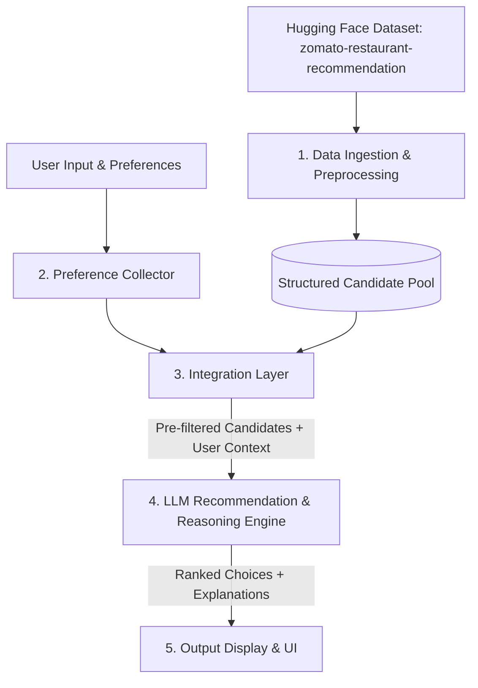

# Problem Statement: AI-Powered Restaurant Recommendation System (Zomato Use Case)

---

## 1. Project Overview & Context

Dining decisions in modern urban environments are often fraught with choice paralysis. Platforms like Zomato catalog tens of thousands of eateries across diverse geographies, price segments, and culinary traditions. However, conventional search systems rely primarily on rigid keyword queries and static filters (e.g., sorting by rating or distance). These traditional approaches struggle to capture nuanced, human-like constraints such as:
- *"A cozy, budget-friendly Italian spot suitable for a quiet dinner date"*
- *"A lively family-friendly restaurant serving authentic North Indian cuisine with prompt service"*

This project aims to build an **AI-Powered Restaurant Recommendation System** inspired by Zomato. By harmonizing **structured tabular data** (curated restaurant attributes from the Zomato dataset) with the semantic reasoning and natural-language generation capabilities of a **Large Language Model (LLM)**, the system delivers personalized, explainable, and context-aware dining recommendations.

---

## 2. Core Objectives

The primary goal is to engineer an end-to-end intelligent recommendation pipeline that:
1. **Captures Multi-Faceted User Preferences**: Ingests user criteria including location/city, budget tier, cuisine, minimum rating threshold, and unstructured dietary or experiential requirements (e.g., ambiance, kid-friendly, quick service).
2. **Leverages Real-World Industry Data**: Processes and queries an authentic restaurant dataset sourced from Hugging Face (`ManikaSaini/zomato-restaurant-recommendation`).
3. **Applies Semantic Reasoning via LLM**: Uses an LLM not just as a text generator, but as a ranking and reasoning engine that compares filtered candidate restaurants against user intent.
4. **Delivers Transparent, Human-Like Explanations**: Produces clear, concise, and persuasive justifications detailing *why* each suggested restaurant matches the diner's request.
5. **Provides a Clean, User-Centric Interface**: Formats recommendations with essential metrics (name, cuisine, rating, estimated cost, location) alongside AI-curated insights.

---

## 3. System Workflow & Architecture

The system operates across five core architectural layers:

### 3.1 Data Ingestion & Preprocessing
- **Source**: [Hugging Face: ManikaSaini/zomato-restaurant-recommendation](https://huggingface.co/datasets/ManikaSaini/zomato-restaurant-recommendation)
- **Extraction & Cleaning**:
  - Load tabular records and handle missing values in critical columns (ratings, cost, cuisines, location).
  - Normalize cost values (e.g., clean currency symbols and format numeric costs for two people).
  - Standardize ratings into numerical scales (e.g., extracting 4.1 from "4.1/5" and filtering non-rated entities like "NEW" or "-").
  - Parse multi-cuisine strings into structured tokens/lists.

### 3.2 User Preference Collection
Collect structured and semi-structured input dimensions:
- **Location**: Specific city, neighborhood, or delivery area (e.g., Delhi, Bangalore, Mumbai).
- **Budget Tier**: Categorized as Low, Medium, or High (mapped to approximate cost-for-two brackets).
- **Cuisine**: Preferred culinary style (e.g., North Indian, Italian, Chinese, Continental, Cafe).
- **Rating Threshold**: Minimum customer review rating (e.g., 4.0+).
- **Contextual / Vibe Preferences**: Qualitative preferences such as "outdoor seating", "quick bite", "family dining", "romantic atmosphere", or "vegetarian-friendly".

### 3.3 Integration & Filtering Layer
- Perform deterministic initial filtering to prune the massive restaurant corpus down to a manageable, highly relevant candidate set ($k \approx 10$ to $20$ restaurants) matching the hard criteria (location, rough budget, primary cuisine).
- Format the filtered candidate pool into a structured schema (JSON or concise markdown tables).
- Construct an optimized prompt that injects both the user persona/preferences and candidate metadata into the LLM context.

### 3.4 LLM Recommendation & Reasoning Engine
- **Model Task**:
  - Evaluate the candidate restaurants against qualitative and quantitative criteria.
  - Re-rank the top $N$ candidates (e.g., Top 3 to 5 recommendations).
  - Synthesize a contextual explanation for each recommendation, explicitly linking restaurant features (reviews, signature cuisines, pricing) to the user's articulated desires.
  - Provide an optional summary comparison between top choices (e.g., "Best for Ambiance" vs "Best Value for Money").

### 3.5 Output Display
Present the final curated results in an intuitive, accessible layout:
- **Restaurant Name**
- **Cuisine & Specialties**
- **Aggregate Rating & Review Highlights**
- **Estimated Cost for Two**
- **AI-Generated Explanation** (*"Why this restaurant is recommended for you"*)

---

## 4. Key Data Fields

| Field Name | Description | Example / Range |
| :--- | :--- | :--- |
| `name` | Registered name of the restaurant | *"Toscano"*, *"Bakehub"* |
| `location` / `city` | Geographic area or locality | *"Indiranagar, Bangalore"*, *"Connaught Place, Delhi"* |
| `cuisines` | Comma-separated list of offered cuisines | *"Italian, Continental, Pizza"* |
| `approx_cost` | Estimated cost for two people | *₹800*, *₹1,500* |
| `rate` / `aggregate_rating` | Customer rating score out of 5 | *4.2 / 5.0* |
| `votes` | Total volume of user reviews | *1,250 votes* |
| `highlights` / `type` | Facility tags or dining style | *["Outdoor Seating", "Full Bar", "Casual Dining"]* |

---

## 5. Non-Functional Requirements & Guardrails

- **Latency & Scalability**: Pre-filtering ensures the LLM prompt remains compact, minimizing inference latency and token overhead.
- **Hallucination Prevention**: The prompt strictly instructs the LLM to ground its recommendations exclusively on facts present in the filtered candidate data (preventing fabricated restaurant names or prices).
- **Graceful Fallbacks**: If strict criteria yield zero candidates (e.g., ultra-rare cuisine combination in a small sub-locality), the system provides relaxed search suggestions (e.g., expanding geographic radius or adjacent price tiers).
- **Cost Efficiency**: Structured pre-retrieval guarantees cost-effective token consumption rather than feeding unindexed raw catalogs to the LLM.

---

## 6. Implementation Milestones

1. **Phase 1: Data Pipeline & Exploration**:
   - Download, inspect, and clean the Zomato Hugging Face dataset.
   - Establish structured indexing or dataframe filtering routines.
2. **Phase 2: Recommendation & Prompt Engineering**:
   - Design candidate filtering algorithms.
   - Formulate robust few-shot / structured prompt templates for LLM reasoning and ranking.
3. **Phase 3: Application & User Interface**:
   - Implement backend service logic (Python / FastAPI or Streamlit / Web UI).
   - Create an interactive interface to collect preferences and render rich restaurant cards with AI explanations.
4. **Phase 4: Evaluation & Refinement**:
   - Validate recommendation relevance against various personas (budget solo diner, premium romantic date, family gathering).
   - Benchmark response times and prompt stability.
